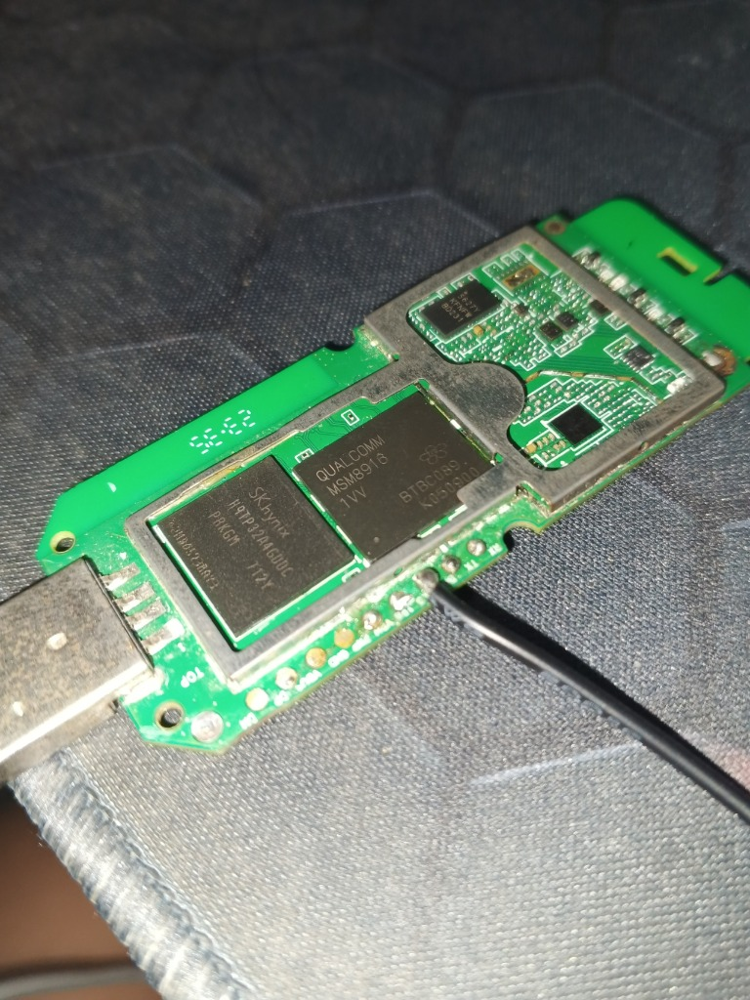
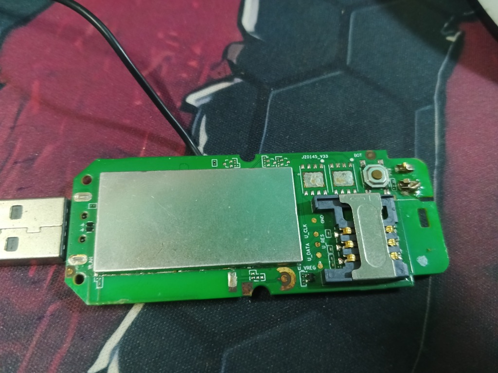

# Hướng Dẫn Cứu Brick & Cài Debian Linux Cho USB 4G Dongle XiaoXun JZ0145_V33 (Qualcomm Snapdragon 410 / MSM8916)

Tài liệu chi tiết và toàn bộ script tự động giúp cứu sống (unbrick) từ trạng thái mất bootloader hoàn toàn (chỉ nhận EDL 9008, không UART, không Fastboot) và cài đặt thành công **Debian GNU/Linux 11 (Bullseye) ARM64** lên USB Wi-Fi 4G Dongle **XiaoXun JZ0145_V33**.

---

## 📌 1. Thông Số Phần Cứng (Hardware Specs)

* **Model bo mạch:** XiaoXun JZ0145_V33 (`msm8916-xiaoxun-jz0145-v33`)
* **Vi xử lý (SoC):** Qualcomm Snapdragon 410 (MSM8916) - 4 nhân ARM Cortex-A53 64-bit (200 MHz - 998.4 MHz)
* **Bộ nhớ (eMCP):** SK Hynix `H9TP32A4GDBC` (BGA221)
  * **RAM:** 512 MB LPDDR3 (382 MB khả dụng cho Linux OS)
  * **Bộ nhớ trong:** 4 GB eMMC 5.0 (3.3 GB cho phân vùng hệ thống rootfs)
* **Wi-Fi / Bluetooth:** Qualcomm Atheros WCN3620 / WCN3660
* **Modem di động:** Qualcomm Gobi 4G LTE (QMI interface `wwan0qmi0`)
* **Hệ điều hành đích:** Debian GNU/Linux 11 (Bullseye) aarch64, Kernel 5.15

---

## 📷 2. Sơ Đồ Chân & Điểm Boot (Pinout & Test Points)

### Mặt trước bo mạch (Điểm Boot & UART):


* **Điểm Boot (EDL Test Point):** Nằm ở mép cạnh mạch gần chip Snapdragon 410 (như trong ảnh có dây đen hàn vào). Khi chạm điểm này vào vỏ sắt USB (GND) và cắm điện, máy sẽ bị ép vào chế độ nạp khẩn cấp **Qualcomm HS-USB QDLoader 9008**.
* **Chân UART Debug:** Gồm 3 điểm tròn `TX`, `RX`, `GND` (mức logic 1.8V, baudrate 115200). Không bắt buộc hàn vì giải pháp này dùng 100% cổng USB.

### Mặt sau bo mạch (Khay SIM & Anten):


* **Khay SIM:** Chuẩn Micro SIM.
* **Cụm test pad SIM 2 (eSIM):** `U_DATA`, `U_CLK`, `U_RES`, `U_VREG`.
* **Đèn LED hiển thị:** 
  * LED Đỏ: **GPIO 6** (sysfs `396`)
  * LED Xanh lá: **GPIO 7** (sysfs `397`)
  * LED Xanh dương: **GPIO 8** (sysfs `398`)

---

## ⚠️ 3. Ba "Cạm Bẫy" Kỹ Thuật Lớn & Cách Khắc Phục (Root Cause Analysis)

### Bẫy 1: Lỗi Gói Ngắn (Short Packet Bug) trong thư viện Firehose Python (`usblib.py`)
* **Hiện tượng:** Khi nạp GPT hoặc SBL1 trong chế độ EDL 9008, loader Firehose nạp được vài chục KB thì báo lỗi Win32 `ERROR_GEN_FAILURE (code 31)` hoặc mất phản hồi ACK.
* **Nguyên nhân:** Loader Firehose của Qualcomm luôn gửi một gói tin phản hồi ngắn `<response value="ACK" rawmode="true" />` (~120 bytes) trước khi truyền dữ liệu thô. Trong hàm `usblib.py`, code chỉ chấp nhận gói tin có kích thước tròn 512 bytes (`wMaxPacketSize`). Khi nhận gói ngắn 120 bytes, hàm cố đọc tiếp lần 2 làm tràn bộ đệm USB của Windows và vứt bỏ mất gói ACK.
* **Khắc phục:** Sửa `usblib.py` để thoát vòng lặp ngay khi nhận được gói ngắn (`len(chunk) < wMaxPacketSize`), lưu giữ nguyên vẹn dữ liệu phản hồi ACK.

### Bẫy 2: `fastboot.exe` không nhận diện thiết bị trên Windows
* **Hiện tượng:** Cắm dongle vào Windows nhận `VID_18D1&PID_D00D` (Android Bootloader), nhưng chạy `fastboot.exe devices` thì không hiện thiết bị nào.
* **Nguyên nhân:** Trình điều khiển WinUSB cài qua Zadig tự sinh ngẫu nhiên `DeviceInterfaceGUID`, trong khi `fastboot.exe` của Google chỉ tìm đúng GUID `{F72548D4-95D9-40BA-AB10-E20782679291}`.
* **Khắc phục:** Viết script nạp trực tiếp qua `pyusb` và thư viện `libusb-1.0.dll`. Giao thức Fastboot là chuẩn USB Bulk Transfer thông thường (Endpoint OUT `0x01`, IN `0x81`), kết nối trực tiếp theo VID/PID mà không phụ thuộc vào GUID Windows.

### Bẫy 3: Treo khi nạp `rootfs.img` qua Fastboot USB
* **Hiện tượng:** Nạp `boot.img` (13MB) thành công rất nhanh, nhưng khi nạp `rootfs.img` chia nhỏ (180MB) thì bị timeout ngay sau 0.6MB.
* **Nguyên nhân:** File Android Sparse Image chứa các header nhỏ (28 bytes header, 12 bytes chunk). Nếu truyền từng mẩu nhỏ này trực tiếp qua USB, mỗi mẩu nhỏ là một gói tin ngắn (< 512 bytes), khiến chip USB hiểu nhầm là đã kết thúc truyền và tạm dừng (stall).
* **Khắc phục:** Sử dụng bộ đệm (Stream Buffer) gom dữ liệu thành các khối chẵn đúng **1 MB** (`2048 * 512 bytes`). Toàn bộ quá trình truyền 100% dùng gói đầy đủ 512 bytes, chỉ gói cuối cùng mới kết thúc truyền.

---

## 🚀 4. Quy Trình Cứu Boot & Cài Đặt Tự Động (Step-by-Step)

### Bước 1: Chuẩn bị môi trường máy tính
1. Cài đặt Python 3.10 hoặc 3.11 trên Windows:
   ```cmd
   pip install pyusb paramiko
   ```
2. Đảm bảo có sẵn thư viện `libusb-1.0.dll` (nằm trong thư mục `edlclient/Windows/`).

### Bước 2: Nạp phân vùng cứu hộ qua Qualcomm EDL 9008
1. Chạm dây điểm boot vào vỏ sắt USB (GND) và cắm vào máy tính.
2. Kiểm tra Device Manager hiện cổng: `Qualcomm HS-USB QDLoader 9008`.
3. Chạy script cứu hộ:
   ```cmd
   python scripts/auto_recover_and_flash.py
   ```
4. Script sẽ tự động:
   * Nạp loader Firehose vào RAM chip.
   * Xóa sector đầu tiên của phân vùng `boot` (Sector 526336) bằng `zeros_1sector.bin`.
   * Gửi lệnh `reset`. Khi chip khởi động lại, thấy phân vùng `boot` trống, Little Kernel sẽ tự động chuyển sang chế độ **Google Fastboot mode (`18D1:D00D`)**.

### Bước 3: Nạp Debian Rootfs & Linux Kernel qua Fastboot
Ngay sau khi thiết bị vào Fastboot, script `auto_recover_and_flash.py` sẽ tự động tiếp tục:
1. **Chia nhỏ `rootfs.img`:** Tự động cắt `rootfs.img` thành 5 phần (mỗi phần ~175 MB < ngưỡng an toàn 180 MB của bộ nhớ đệm RAM dongle).
2. **Nạp 5 phần rootfs:** Truyền dữ liệu có đệm 1MB và ghi trực tiếp vào phân vùng eMMC `rootfs`. Sau mỗi phần đều kiểm tra mã phản hồi `OKAY` từ chip.
3. **Nạp `boot.img`:** Nạp Kernel Linux vào phân vùng `boot` (13.5 MB trong 1 giây).
4. **Khởi động lại:** Gửi lệnh `reboot` để dongle boot thẳng vào Debian Linux!

---

## ⚙️ 5. Các Tinh Chỉnh & Cấu Hình Sau Cài Đặt (Post-Install)

Sau khi dongle khởi động thành công, bạn có thể kết nối ngay qua ADB:
```cmd
adb shell
```

### 1. Sửa lỗi kết nối Wi-Fi WPA2/WPA3 (SAE Error)
Nếu router Wi-Fi của bạn dùng chế độ bảo mật kép WPA2/WPA3, lệnh `nmcli dev wifi connect` thông thường sẽ báo lỗi `(7) Secrets were required, but not provided`. Cách sửa:
```bash
nmcli con add type wifi con-name "Ten_Wifi" ifname wlan0 ssid "Ten_Wifi" wifi-sec.key-mgmt wpa-psk wifi-sec.psk "Mat_Khau_Wifi"
nmcli con up "Ten_Wifi"
```
Dongle sẽ kết nối Wi-Fi thành công và nhận địa chỉ IP nội bộ (ví dụ: `192.168.1.165`).

### 2. Kích hoạt SSH & Đổi mật khẩu
Mở quyền đăng nhập root qua SSH:
```bash
sed -i 's/#PermitRootLogin prohibit-password/PermitRootLogin yes/' /etc/ssh/sshd_config
systemctl restart ssh
```
Mật khẩu mặc định:
* Tài khoản: `root` | Mật khẩu: `1`
* Tài khoản: `user` | Mật khẩu: `1`

Bây giờ bạn có thể rút dongle cắm vào củ sạc ở bất cứ đâu trong nhà và SSH điều khiển qua Wi-Fi:
```bash
ssh root@192.168.1.165
```

### 3. Tăng bộ nhớ ảo Swap lên 1.2 GB (Chống tràn RAM OOM)
Dongle có 512 MB RAM vật lý. Để cài các ứng dụng nặng (Docker, Python, Node.js...) mà không bị văng:
```bash
fallocate -l 1G /swapfile || dd if=/dev/zero of=/swapfile bs=1M count=1024
chmod 600 /swapfile
mkswap /swapfile
swapon -p 10 /swapfile
echo '/swapfile none swap sw,pri=10 0 0' >> /etc/fstab
```
Hệ thống sẽ có tổng cộng **~1.6 GB bộ nhớ ảo** (191MB ZRAM nén siêu tốc ưu tiên 100 + 1024MB eMMC swapfile ưu tiên 10).

### 4. Đèn LED chế độ cảnh báo lỗi (Stealth Mode)
Để đèn không sáng chói mắt vào ban đêm, cấu hình chế độ chỉ bật đèn ĐỎ khi rớt mạng hoặc mất kết nối Wi-Fi:
* Xem chi tiết script tại [scripts/setup_error_led.py](scripts/setup_error_led.py).

---

## 📄 License & Credits
* Dựa trên dự án mã nguồn mở **OpenStick** và **HandsomeOpenstick**.
* Tài liệu và script tổng hợp, tối ưu bởi **NguyenPhat-NT**.
